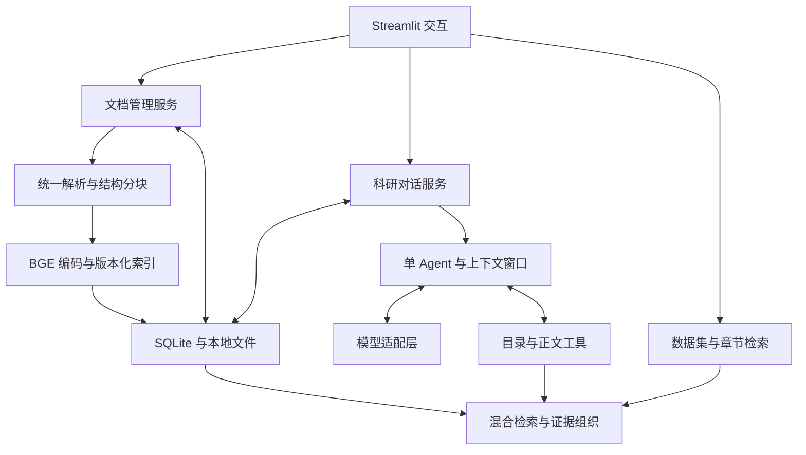
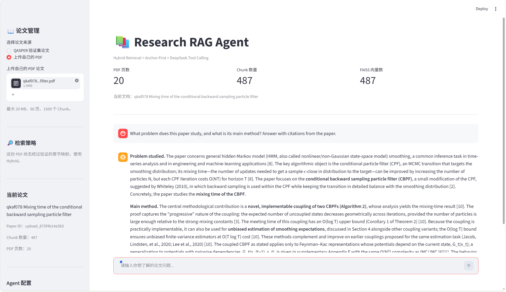
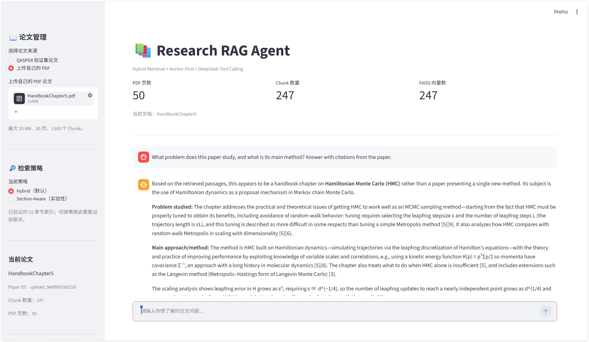
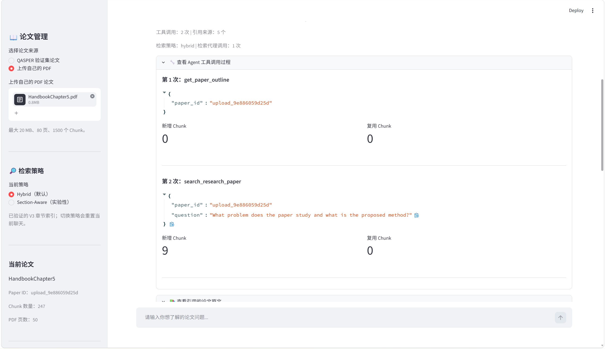
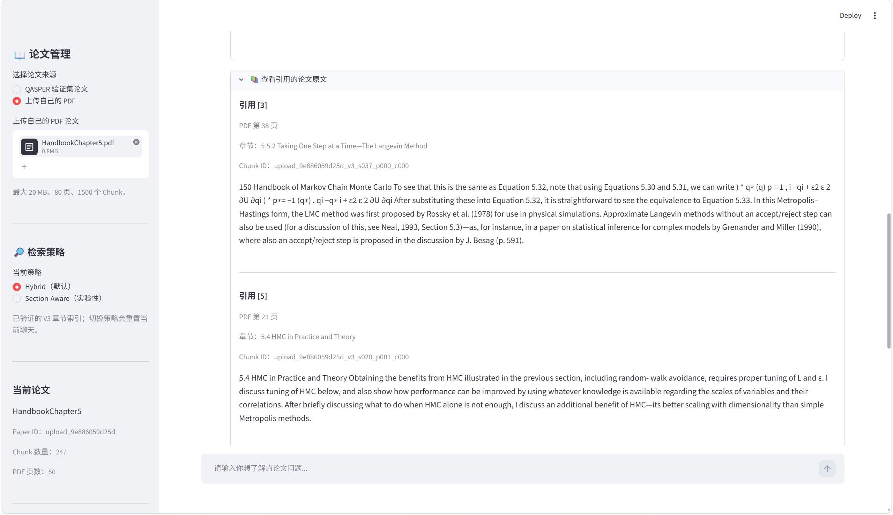

# Research RAG Agent

**面向科研文献的可追溯问答助手：多格式文档 · 混合检索 · 工具调用 · 持久化会话。**

上传论文、Word 或 Markdown 文档，解析并建立知识索引后，通过多轮对话查找研究方法、实验结论和原文证据。系统将回答与文档位置关联，支持查看引用片段、恢复历史会话和导出 Markdown；同时提供 QASPER 数据集检索与章节感知实验。

[快速开始](#快速开始) · [使用指南](docs/user_guide.md) · [系统架构](docs/architecture.md) · [检索评测](docs/benchmark.md) · [章节实验](docs/experiments.md)

## 核心功能

| 模块 | 功能 |
|---|---|
| 文档工作台 | 批量上传 PDF、DOCX、MD、TXT，搜索文档、查看解析状态与处理任务 |
| 结构化分块 | Fixed、Recursive、Structure、Adaptive 策略，结合原文结构、字符与 Embedding Token 预算 |
| 混合检索 | BM25 + BGE-small-en-v1.5 + FAISS，RRF 融合排名，Anchor-First 组织上下文 |
| 科研 Agent | 论文目录与正文检索工具，参数和文档范围校验、工具预算与停止条件 |
| 多轮对话 | 完整回合滑动窗口、历史恢复、流式输出、停止、重新生成和失败重试 |
| 模型配置 | DeepSeek、OpenAI、Claude、Gemini、阿里云百炼及自定义兼容服务的适配入口 |
| 来源追踪 | 稳定数字引用、论文与章节信息、真实 PDF 页码或段落/行号、原文片段 |
| 持久化 | SQLite 保存文档、Chunk、会话和引用；本地保存原文件与不可变 FAISS 索引版本 |
| 数据管理 | 文件哈希去重、索引复用与重建、可恢复的文档移出、备份与恢复 |
| 检索实验 | QASPER 证据级检索评测，以及指定 HMC PDF 的 Section-Aware 章节检索 |

PDF 默认采用 PyMuPDF 文本提取；需要 OCR 或更复杂版面处理时，可配置 Tesseract 或可选的 Docling/RapidOCR 后端。配置与处理提示见 [文档解析](docs/user_guide.md#文档解析与分块)。

## 系统架构



Python 应用服务按解析、存储、检索、生成和会话职责划分。文档处理与向量搜索在本地运行，生成模型通过独立适配层调用。

### 检索与证据组织

1. 查询限定在当前选择的论文与索引版本内。
2. BM25 与 Dense 分别产生候选；Dense 使用归一化 BGE 向量和 FAISS IndexFlatIP。
3. RRF 根据排名融合，常数 `k=60`：

$$
\operatorname{RRF}(d)=\sum_{r\in R}\frac{1}{60+\operatorname{rank}_r(d)}
$$

4. Anchor-First 优先保留命中的证据，再补充同组邻段；上下文按预算选择完整证据块。
5. Agent 注册来源编号，将工具结果回传模型，再保存回答、消息与引用关系。

### Agent 与上下文

| 工具 | 输入 | 输出 |
|---|---|---|
| `get_paper_outline` | 当前文档 ID | 文档标题、章节/页码标签与 Chunk 统计 |
| `search_research_paper` | 当前文档 ID、检索问题 | 证据正文、来源位置与引用元数据 |

Agent 由 Python 校验并执行工具；单次问答最多进行五轮模型请求、两次工具尝试。每次请求前，根据输入预算选择完整历史回合，保持工具调用与返回消息配对。生成输入采用明确标记的预算估算，Embedding 分块使用 BGE 的实际 tokenizer。

## 快速开始

本地验证环境：Windows、Python 3.13.9、CPU。

```powershell
git clone https://github.com/cldw1/research-rag-agent.git
cd research-rag-agent
python -m venv .venv
.\.venv\Scripts\python.exe -m pip install --upgrade pip
.\.venv\Scripts\python.exe -m pip install -r requirements.txt
Copy-Item .env.example .env
.\.venv\Scripts\python.exe -m streamlit run app.py --server.address 127.0.0.1 --server.port 8501
```

打开 [本地应用](http://localhost:8501)：

1. 进入 **文档工作台**，上传文档，点击“保存并解析上传文档”。
2. 查看解析结果和分块来源，点击“构建或复用持久化索引”。
3. 进入 **科研对话**，选择文档并新建会话。
4. 选择模型供应商、填写 API Key 和参数，开始问答；历史与引用自动保存。
5. 需要运行数据集或章节实验时，使用首页的 QASPER / PDF 检索区域。

BGE 首次使用会下载到 `models/embedding_cache/`；已有完整缓存后可离线运行文档编码和检索。API Key 可直接在科研对话页面输入，也可使用 `.env` 中的可选默认配置。文档解析与建索引不需要生成模型 Key。

### QASPER 数据准备

交互式 QASPER 示例使用固定种子选出的 30 篇 Validation 论文，每篇一道问题；此示例与完整 Test 检索评测分别保存。

```powershell
.\.venv\Scripts\python.exe scripts/prepare_validation_sample.py
.\.venv\Scripts\python.exe scripts/build_validation_faiss.py
```

生成的 Chunk、向量和索引保存在 `data/processed/`。上传自己的文档无需执行这两步。

## 检索评测

### QASPER 文本证据检索

主实验采用官方 Test 的 416 篇论文、1451 个问题，按预先固定规则纳入可唯一对齐正文的文本证据题。相同分块和 BGE 模型下比较 BM25、Dense、Hybrid，另以相同上下文预算比较 Top-5 与 Anchor-First。

纳入 **1216 个问题、400 篇评分论文**，索引共 **17474 个 Chunk**。结果如下：

| 方法 | Hit@5 | Recall@5 | MRR@5 | nDCG@5 |
|---|---:|---:|---:|---:|
| BM25 | 64.72% | 51.04% | 0.3908 | 0.3767 |
| Dense | 66.94% | 54.29% | 0.4279 | 0.4098 |
| Hybrid | 73.77% | 60.05% | 0.4723 | 0.4507 |

Hybrid 相对 Dense 的 Hit@5 提高 **6.83 个百分点**，按论文聚类的配对 95% bootstrap 区间为 **[4.42, 9.26] 个百分点**。同一证据预算下，Anchor-First 的段落覆盖从 60.05% 增至 64.37%。配置、筛选、完整指标和上下文长度见 [实验报告](docs/benchmark.md) 与 [结构化结果](results/qasper_test_summary.json)。

对 263 道失败案例进一步复现来源与排序，并在独立 Validation 的 841 题上比较融合参数。对照支持保留当前等权 RRF 默认配置，详见 [误差分析与参数验证](docs/retrieval_analysis.md)。

[六个代表性案例](docs/case_studies.md) 对照问题、Gold 与检索片段，解释融合退化、自然段合并及候选截断，并区分原始检索失误与证据扩展后的来源覆盖。

### HMC 章节感知检索

在 *MCMC Using Hamiltonian Dynamics* 的指定 50 页 PDF 上，使用 247 个 V3 Chunk 和 7 道章节级问题比较两种检索策略：

| 指标 | Hybrid | Section-Aware |
|---|---:|---:|
| Hit@5 | 85.7%（6/7） | 100.0%（7/7） |
| MRR@5 | 0.786 | 0.929 |
| 人工证据充分率 | 85.7%（6/7） | 85.7%（6/7） |

该实验展示章节元数据对排序的作用，范围为同一篇论文的七题。完整逐题结果、指标口径与复现命令见 [章节实验报告](docs/experiments.md) 和 [结构化摘要](results/hmc_v3_public_summary.json)。

## 数据存储

默认目录为 `data/copilot_v2/`，可通过 `COPILOT_DATA_DIR` 配置：

| 内容 | 保存方式 |
|---|---|
| 文档与解析版本、Chunk、任务 | SQLite `catalog.sqlite` |
| 会话、回合、消息、引用关系 | 同一 SQLite 数据库 |
| 原始文档 | `objects/<SHA256>` |
| 向量与 FAISS 索引 | `indexes/<索引ID>/vectors.npy`、`index.faiss` |
| 模型、Chunk 和文件对应关系 | 索引配置与 `manifest.json` 校验清单 |

新索引写入并校验后，再在事务中切换活动版本。重启时读取已保存的解析结果、Chunk 和索引；会话与引用绑定具体版本，保证历史来源可追溯。备份和 CLI 管理见 [使用指南](docs/user_guide.md#数据管理与备份)。

## 功能截图

**论文选择与问答**


**PDF 文献检索与引用**



**章节感知检索**


<details>
<summary>查看 Hybrid 问答、工具调用与原文证据</summary>







</details>

## 测试与复现

```powershell
.\.venv\Scripts\python.exe -m pip install -r requirements-dev.txt
.\.venv\Scripts\python.exe -m pytest -q
.\.venv\Scripts\python.exe scripts/check_github_safety.py
```

测试覆盖文档解析、来源与分块预算、混合检索、RRF、索引与会话恢复、完整回合窗口、工具调用、引用、流式状态、删除与重建、备份及界面启动。生成协议使用 Mock 验证；真实 BGE 的跨进程持久化检查可通过下列脚本运行：

```powershell
.\.venv\Scripts\python.exe scripts/smoke_conversations.py --output results/chat_check.json
```

检索实验与功能测试分别报告，便于区分证据排名、软件行为和生成回答质量。

## 项目结构

```text
research-rag-agent/
├── app.py                  # 应用入口、QASPER / PDF 检索
├── pages/                  # 文档工作台、科研对话
├── src/
│   ├── ingestion/          # 多格式解析与结构分块
│   ├── storage/            # 数据库、原始文件、索引、会话、备份
│   ├── retrieval/          # BM25、Dense、RRF、章节策略与证据扩展
│   ├── generation/         # RAG Pipeline 与证据上下文
│   ├── agent/              # 工具调用循环、上下文窗口、引用
│   ├── llm/                # 模型配置与供应商协议适配
│   └── evaluation/         # 证据匹配、指标与统计区间
├── scripts/                # 数据准备、评测、管理与集成检查
├── tests/                  # 离线单元和集成测试
├── results/                # 可公开的结构化实验结果
└── docs/                   # 使用指南、架构、实验与截图
```

技术栈：Python、Streamlit、SQLAlchemy、SQLite、PyMuPDF、Sentence-Transformers / BGE、BM25、FAISS、NumPy、Hugging Face Datasets、LLM API、pytest。
