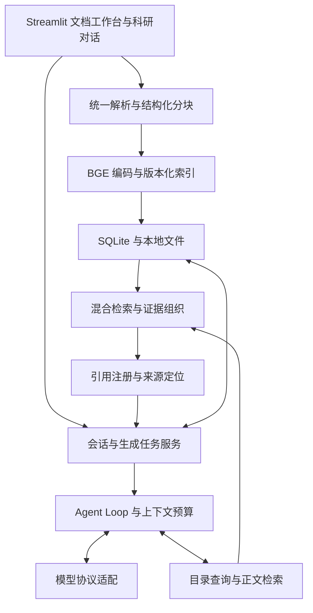
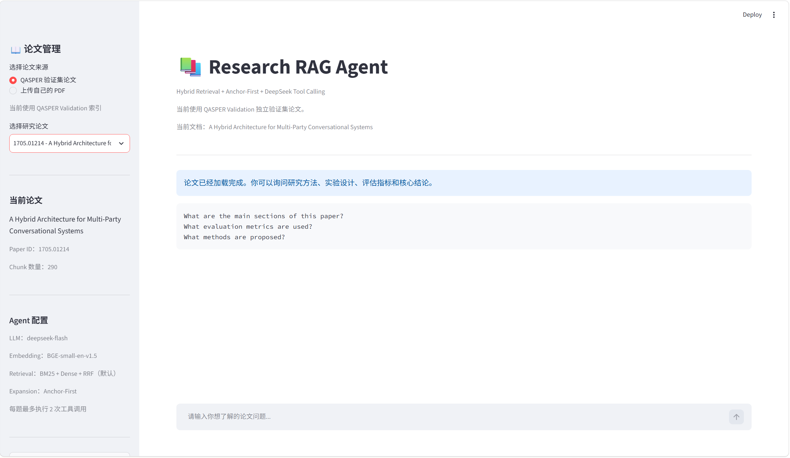
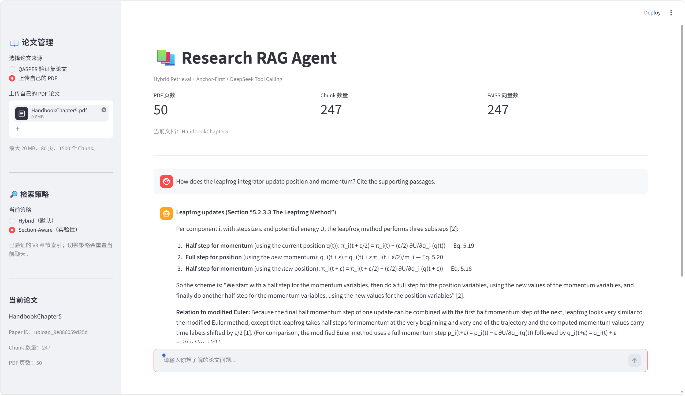

# Research RAG Agent

**面向科研文献的可追溯问答助手：多格式文档、混合检索、工具调用与持久化会话。**

Research RAG Agent 是一个面向科研阅读与文献分析的智能助手，将文档解析、结构化分块、混合检索、Agent 工具调用和会话管理整合在同一应用中。用户可以建立自己的本地文献库，围绕研究背景、方法设计、实验结果和论文局限开展多轮问答，也可以选择多篇论文进行对比分析，通过关联原文的引用检查回答依据，减少在长文档之间反复搜索和核对信息的成本。

系统支持 **PDF、DOCX、Markdown 和 TXT** 批量上传，统一提取章节、段落、表格等结构与来源信息；扫描文档可按需接入 Tesseract 或 Docling/RapidOCR。分块结合文档结构、段落边界与 Embedding Token 预算，提供固定、递归、结构化和自适应等策略。PDF 保留真实页码，Word 使用段落位置，Markdown 与 TXT 使用段落或行号，使检索片段能够追溯到原始文档。

检索采用 **BM25 + BGE-small-en-v1.5 + FAISS**，通过 RRF 融合关键词与语义召回，并使用 Anchor-First 优先组织命中证据、按预算补充邻近段落。多文献问答支持在 **1–5 篇所选文档** 内联合检索，按论文分配候选并区分来源。原生 Python Agent 通过 Tool Calling 查询论文目录或检索正文，由程序校验工具参数、文档范围与调用次数；回答中的稳定引用编号关联具体文档、Chunk 和索引版本，便于核对不同论文的结论与证据。

应用使用 **SQLAlchemy + SQLite** 保存文档、分块、处理任务、会话、消息与引用，本地文件系统保存原始文件和版本化向量索引，支持哈希去重、索引复用、重启恢复及备份还原。对话上下文按输入预算选择完整历史回合，保留工具请求与返回消息的配对关系。生成模型通过独立适配层接入 DeepSeek、OpenAI、Claude、Gemini、百炼及自定义兼容服务；Streamlit 界面提供文档管理、模型配置、流式回答、停止生成、历史恢复与 Markdown 导出。

项目同时提供固定数据与协议下的检索、分块和多文献问答实验。在 **QASPER Test 的 1,216 道证据检索题** 上，Hybrid 的 **Hit@5 达到 73.77%**，较 Dense 提高 **6.83 个百分点**；在同一批 **841 道 Validation 题** 上，自适应分块的 Hybrid Hit@5 为 **73.72%**，结构化分块为 **68.25%**。实验配置、逐题指标、统计区间和复现脚本随仓库提供，便于核查结果并继续开展控制变量实验。

[快速开始](#快速开始) · [使用指南](docs/user_guide.md) · [系统架构](docs/architecture.md) · [评测结果](docs/evaluation.md) · [QASPER 协议](docs/benchmark.md)

## 核心功能

| 模块 | 能力 |
|---|---|
| 文献管理 | 批量上传 PDF、DOCX、MD、TXT，预览解析结构、来源位置、Chunk 与任务状态 |
| 文档解析 | PyMuPDF 文本提取、OOXML 结构解析；可选 Tesseract 或 Docling/RapidOCR 处理扫描文档 |
| 结构化分块 | Fixed、Recursive、Structure、Adaptive 与可选 HybridChunker，结合结构和 Embedding Token 预算 |
| 混合检索 | BM25 + BGE-small-en-v1.5 + FAISS，等权 RRF 融合与 Anchor-First 证据组织 |
| 多文献问答 | 选择 1–5 篇已索引文档，按论文分配候选，区分不同文献的证据与引用 |
| 科研 Agent | 原生 Python Tool Calling，目录查询与正文检索，工具参数、文档范围和执行预算校验 |
| 上下文管理 | 按输入预算选择完整历史回合，保留工具调用及返回消息的配对关系 |
| 对话体验 | 流式生成、停止、重新生成、历史恢复、重命名、Markdown 导出 |
| 模型适配 | DeepSeek、OpenAI Responses、Claude、Gemini、百炼和自定义 OpenAI-compatible 服务 |
| 引用追踪 | 会话内稳定编号，关联具体文档、索引版本、Chunk、PDF 页码或段落/行号 |
| 持久化 | SQLAlchemy + SQLite 保存文档、Chunk、任务、会话和引用；本地文件保存原文与版本化 FAISS 索引 |
| 数据维护 | 文件哈希去重、索引复用与重建、可恢复的文档移出、备份与恢复 |

生成模型与 Embedding 分开配置。API Key 使用密码输入框，用户输入默认只保存在当前会话或服务内存中。原始文档与索引保存在本地；生成时向所选供应商发送本轮问题、选中的历史与证据。

## 系统架构



文档处理、存储、检索、模型协议和会话编排采用独立模块。完整数据流、版本关系与代码入口见 [系统架构](docs/architecture.md)。

### 检索与证据组织

1. 将查询限定在当前会话选择的文档及对应索引版本中。
2. BM25 与 Dense 分别召回；Dense 使用归一化 BGE 向量和 FAISS IndexFlatIP。
3. 等权 RRF 融合排名，默认常数为 60。
4. 多文档检索按论文分配候选；Anchor-First 优先保留命中证据，再按预算扩展相邻段落。
5. 为证据注册稳定引用，生成回答后保存本轮配置、消息和来源关系。

### Agent 与上下文

| 工具 | 输入 | 输出 |
|---|---|---|
| `get_paper_outline` | 会话范围 ID 或其中一篇文档 ID | 按文档区分的章节/页面标签与 Chunk 统计 |
| `search_research_paper` | 会话范围、检索问题及可选文档 ID | 证据文本、来源位置、排名与文档覆盖信息 |

Agent 负责调用模型、校验工具参数、执行工具并回传结果。单轮问答最多进行五轮模型请求和两次工具尝试；可选证据补检最多增加一次生成请求。每次请求前按预算选择完整历史回合，避免拆散工具请求与返回消息。生成上下文采用带封装余量的预算估算，Embedding 分块使用 BGE 的真实 tokenizer。

多文档证据顺序、证据不足时补检一次、强调来源与实验条件均可在界面选择；默认使用 RRF，后两项默认关闭。配置、作用范围和成本见 [使用指南](docs/user_guide.md)。

## 快速开始

本地验证环境：Windows、Python 3.13.9、CPU。

```powershell
git clone https://github.com/cldw1/research-rag-agent.git
cd research-rag-agent
python -m venv .venv
.\.venv\Scripts\python.exe -m pip install --upgrade pip
.\.venv\Scripts\python.exe -m pip install -r requirements.txt
Copy-Item .env.example .env
.\.venv\Scripts\python.exe -m streamlit run app.py --server.address 127.0.0.1 --server.port 8501
```

打开 [本地应用](http://localhost:8501)：

1. 进入 **文档工作台**，批量上传文件并保存解析结果。
2. 检查结构与来源，选择分块策略，构建或复用持久化索引。
3. 进入 **科研对话**，选择 1–5 篇文档并新建会话。
4. 选择模型供应商，填写模型名、API Key 和参数，开始问答。
5. 展开引用查看原文，或恢复历史会话、导出 Markdown。

BGE 首次使用会下载到 `models/embedding_cache/`，有缓存后可离线处理与检索。文档建索引不需要生成模型 Key。默认数据目录为 `data/copilot_v2/`，可通过 `COPILOT_DATA_DIR` 配置。

扫描文档可选用 OCR；依赖、模型目录与语言配置见 [文档解析与分块](docs/user_guide.md#文档解析与分块)。备份、恢复和已有数据库兼容操作见 [数据管理与备份](docs/user_guide.md#数据管理与备份)。

### QASPER 数据准备

首页保留 QASPER 论文检索与指定 PDF 的章节检索入口。交互示例使用固定种子选择的 30 篇 Validation 论文，每篇一个问题；与 Test 评测产物分别保存。

```powershell
.\.venv\Scripts\python.exe scripts/prepare_validation_sample.py
.\.venv\Scripts\python.exe scripts/build_validation_faiss.py
```

生成文件保存在 `data/processed/`。上传自己的文档可直接使用文档工作台。

## 评测结果

### QASPER 证据级检索

使用官方 Test 数据建立 416 篇论文、17,474 个 Chunk 的索引；按固定规则纳入 400 篇论文的 1,216 道文本证据题。三种方法使用相同分块、问题与论文范围。

| 方法 | Hit@5 | Recall@5 | MRR@5 | nDCG@5 |
|---|---:|---:|---:|---:|
| BM25 | 64.72% | 51.04% | 0.3908 | 0.3767 |
| Dense | 66.94% | 54.29% | 0.4279 | 0.4098 |
| Hybrid | **73.77%** | **60.05%** | **0.4723** | **0.4507** |

Hybrid 相对 Dense 的 Hit@5 提高 **6.83 个百分点**，论文级配对 bootstrap 95% 区间为 **[4.42, 9.26] 个百分点**。同一证据预算下，Anchor-First 将来源段落覆盖从 60.05% 提高至 64.37%。完整协议、指标和耗时见 [QASPER 评测](docs/benchmark.md)，原始汇总见 [结构化结果](results/qasper_test_summary.json)。

### 分块与多文献实验

| 对照 | 数据范围 | 结果 |
|---|---|---|
| 自适应 / 结构分块 | QASPER Validation，同一批 841 题 | Hybrid Hit@5 为 73.72% / 68.25%；Chunk 数为 11,956 / 17,588 |
| 全局 / 按论文分配证据 | 3 篇论文的跨文档开发题，10 道有 Gold 的问题 | 目标论文出现率 77.78% / 100%；完整证据 Recall 为 32.50% / 44.17% |
| Hybrid / Section-Aware | 指定 HMC PDF，7 道章节问题 | Hit@5 为 6/7 / 7/7；MRR@5 为 0.786 / 0.929 |

真实 PDF 评测集包含 **10 篇论文、150 道候选题、205 处证据定位**，按论文划分为 45 道开发题与 105 道预留测试题。开发集已完成 45 次 DeepSeek 回答及来源初审；参考标注与回答审核状态随结果保留，预留测试集未用于报告成绩。

多文献回答、证据顺序、补检和提示约束另有固定协议与逐题对照，包含改善与退步案例。数据划分、Token 用量、审核口径和结果解释统一见 [评测结果与复现](docs/evaluation.md)。

## 数据存储

SQLite 保存文档、Chunk、任务、会话、消息与引用，本地文件系统保存原始文档、向量与 FAISS 索引。

新索引写入并通过校验后，再事务性切换活动版本。重启后复用已保存的解析和索引；会话与引用绑定具体版本，文档重建后通过新会话使用新索引。数据维护命令见 [使用指南](docs/user_guide.md#数据管理与备份)。

## 功能截图

<details>
<summary>展开查看问答、工具调用与引用展示</summary>






</details>

## 测试与复现

```powershell
.\.venv\Scripts\python.exe -m pytest -q
.\.venv\Scripts\python.exe scripts/check_github_safety.py
.\.venv\Scripts\python.exe scripts/run_qasper_benchmark.py --split test --threads 8
```

自动化测试使用固定样本与 Mock，覆盖文档解析、分块、存储、检索融合、Agent Loop、工具消息配对、引用和会话恢复。有本地冻结数据或模型缓存的集成检查按条件运行。

[完整流程检查](scripts/acceptance_workflow.py) 验证四种文档入库、跨进程历史恢复、引用导出、备份和索引失效；默认使用固定响应，显式添加 `--live` 才调用生成模型。复现各组检索和回答实验的命令见 [评测文档](docs/evaluation.md)。

## 项目结构

```text
app.py                    # QASPER 与 PDF 检索入口
pages/                    # 文档工作台、科研对话
src/
├── ingestion/            # 统一文档结构、解析与分块
├── storage/              # SQLAlchemy 持久化与文件管理
├── retrieval/            # BM25、FAISS、融合与多文档检索
├── generation/           # 证据上下文、回答规则与引用
├── agent/                # Agent Loop、工具与上下文预算
├── llm/                  # 模型供应商协议适配
└── evaluation/           # 评测指标、证据对齐与结果审核
benchmarks/               # 固定问题、Gold 与实验协议
results/                  # 公开指标、逐题记录与统计汇总
scripts/                  # 数据准备、评测与维护命令
tests/                    # 单元测试和集成检查
docs/                     # 使用指南、架构与评测说明
```
