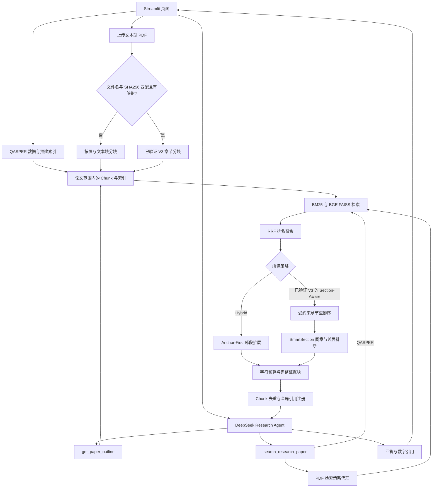
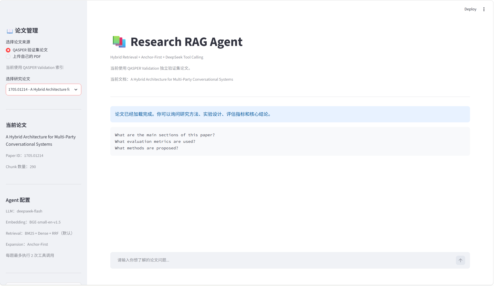
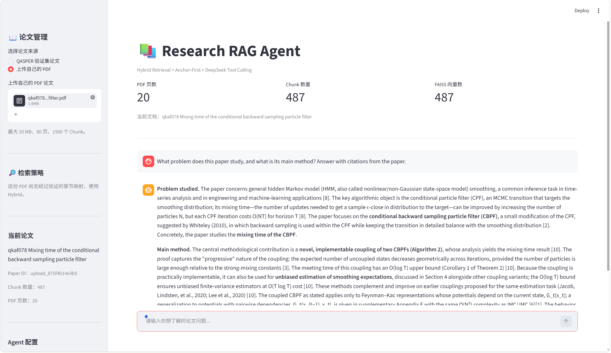
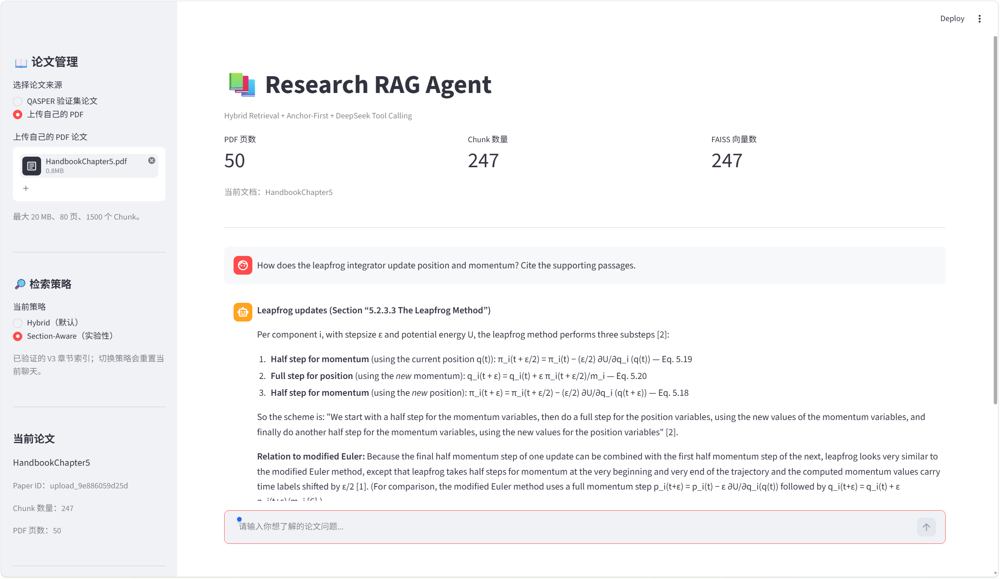
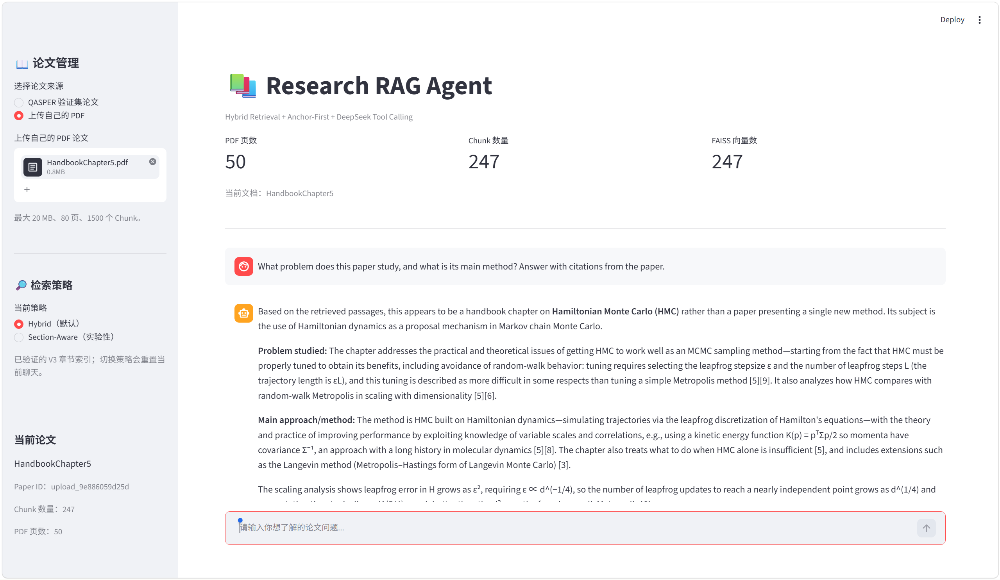
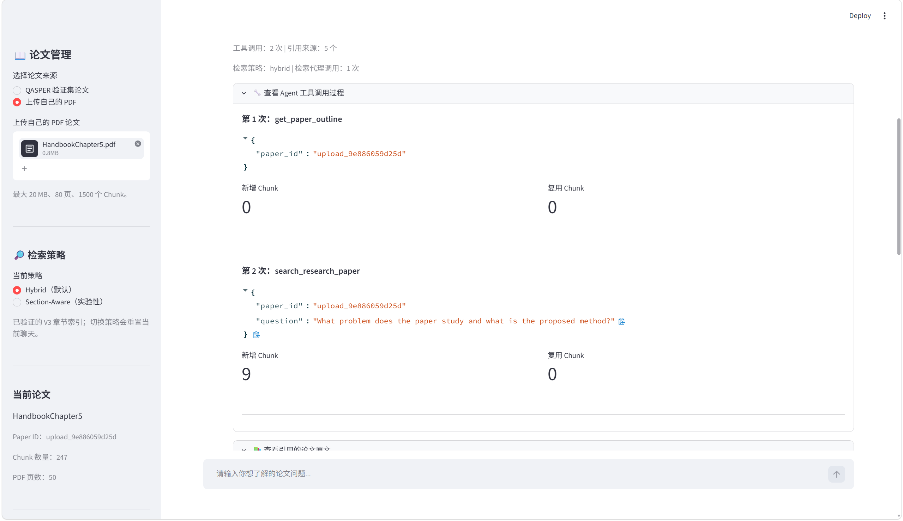
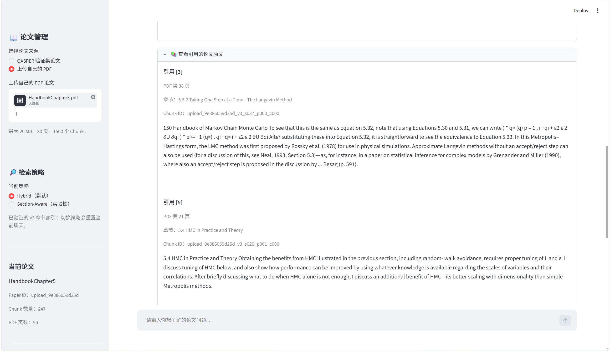

# Research RAG Agent

**面向英文科研论文的可追溯问答原型：Hybrid Retrieval · DeepSeek Tool Calling · 章节感知检索实验。**

从 QASPER Validation 论文或本地文本型 PDF 中检索证据，由 Agent 选择论文目录与正文搜索工具，生成带数字引用的回答，并在 Streamlit 中查看工具调用、页码和对应原文。

- **检索工程**：BM25 + BGE-small-en-v1.5 + FAISS，通过 RRF 融合关键词与语义排名。
- **Agent 工程**：两个受约束工具、论文范围校验、工具调用预算、会话内 Chunk 去重与引用编号复用。
- **证据组织**：Anchor-First 优先保留检索片段；已验证 V3 的 Section-Aware 模式支持同章节跨页邻居扩展。
- **可核验评估**：单篇 HMC 论文的 7 道章节级问题，Hit@5 为 6/7 → 7/7，人工证据充分率均为 6/7。**结果不能推广为通用问答性能提升。**

[安装运行](#安装与启动) · [实验详情](docs/experiments.md) · [截图说明](docs/images/README.md) · [简历与面试说明](docs/resume_project.md)

## 功能与支持范围

| 能力 | QASPER Validation | 普通 PDF | 已验证 HMC V3 PDF |
|---|---|---|---|
| 数据准备 | 先运行两步准备脚本 | 页面上传并本地建索引 | 上传指定版本 PDF，并加载已发布映射 |
| 索引范围 | 固定种子抽取的 30 篇论文，按所选论文检索 | 当前上传论文 | 当前上传论文 |
| Hybrid 检索 | 支持 | 默认 | 默认 |
| 结构信息 | 数据集章节元数据 | `Page X` 页码标签 | 固定映射的真实章节标题 |
| Section-Aware | 当前 UI 不提供 | 不开放，保持 Hybrid | 可选实验模式 |
| 邻近证据扩展 | Anchor-First | Anchor-First，同页邻段 | Hybrid 用 Anchor-First；Section-Aware 用 SmartSection |
| 引用追踪 | 论文、章节、Chunk | 论文、页码、Chunk | 论文、章节、页码、Chunk |

普通 PDF 不是通用章节识别：扫描件不支持 OCR，公式和双栏文本可能有提取误差。上传上限为 **20 MB、80 页、1500 个 Chunk**。索引保存在当前 Streamlit 会话内，重启或会话失效后需重建。

## 系统架构



### 检索与证据流程

1. 用户选定论文，检索始终限制在该论文内。
2. BM25 与 Dense 分别取候选，Dense 使用归一化 BGE 向量与 FAISS 内积。查询添加 BGE 检索指令前缀，正文不添加。
3. RRF 根据两路排名融合，常数 `k = 60`；并列分数按索引位置稳定排序。
4. 默认采用 Hybrid。已验证 V3 可扩展至全部论文 Chunk 候选池，再做章节关键词加分、参考文献降权和章节数量约束。
5. RAG Pipeline 取检索结果的前 5 条作为 Anchor，优先放入上下文，再补充邻居。SmartSection 最多加入 2 个邻居，搜索前后 10 个 Chunk，可跨页但不跨真实章节。
6. 字符预算包含元数据、编号与分隔符；保留完整证据块。预算不足时会减少证据，无法放入首块时返回明确错误。

RRF 公式使用 GitHub 支持的显示数学语法：

$$
\operatorname{RRF}(d)=\sum_{r\in R}\frac{1}{k+\operatorname{rank}_r(d)}
$$

即对每一路排名累加 `1 / (60 + rank)`，不直接相加 BM25 与向量相似度分数。

Section-Aware 默认参数：章节命中奖励 `0.010`、普通问题参考文献惩罚 `0.025`、每章节最多 `2` 条。保留原始 Hybrid Top-1 **进入最终结果集**，但重排后不保证仍排第一；章节不足时返回数量可能少于请求值。

### Agent 工具与引用

| 工具 | 输入 | 返回 |
|---|---|---|
| `get_paper_outline` | 当前 `paper_id` | 标题、章节/页码标签、Chunk 数量 |
| `search_research_paper` | 当前 `paper_id`、检索问题 | 检索与扩展后的证据、引用元数据 |

入口复用 [ResearchAgent](scripts/demo_agent_live_dedup.py)，运行时通过 `RetrievalStrategyProxy` 接入 PDF 策略。首轮要求调用工具，后续由模型决定是否继续；每题最多执行 **2 次工具**、每会话最多 **10 次工具**、每题最多 **5 轮模型交互**。单次检索上下文预算为 7400 字符，引用去重后的证据硬限制为 8000 字符，这些不是整个会话的 token 上限。

工具参数校验阻止访问其他论文；检索文本被提示为参考数据。`(paper_id, chunk_id)` 注册为会话内稳定的数字编号；重复检索复用编号并省略重复全文。回答中的数字引用会与注册表核对，页面显示原文及无效引用提示。**编号存在不等于证据在语义上支持答案**，目前没有自动完成回答忠实度评估。

## 实验结果

历史报告来自 *MCMC Using Hamiltonian Dynamics* 的特定 50 页 PDF：247 个 V3 Chunk、50 条标题匹配记录、7 道章节级问题，返回 Top-5。

| 指标 | V3 Hybrid | Section-Aware |
|---|---:|---:|
| Hit@5 | 85.7%（6/7） | 100.0%（7/7） |
| MRR@5 | 0.786 | 0.929 |
| 人工证据充分率（评分为 2） | 85.7%（6/7） | 85.7%（6/7） |
| 平均证据评分（0–2） | 1.857 | 1.857 |

这是**同一篇论文上的小样本章节检索对比**，标签仍为 provisional，人工评分仅有一名评审。Section-Aware 一题证据评分更好、一题更差、五题相同。章节排名改善没有提高总体人工证据充分率，因此 Hybrid 保持默认。该结果没有衡量回答正确率，也不属于完整 QASPER benchmark。

已发布 [逐题结构化结果](results/hmc_v3_public_summary.json) 和 [实验说明](docs/experiments.md)。公开摘要不含论文长段原文或聊天记录；自动测试可从逐题排名与人工评分重新计算指标。它验证历史数据一致性，不等于重新运行 HMC 检索实验。

## 安装与启动

### 1. Python 与依赖

本次本地验证环境为 **Windows、Python 3.13.9、CPU**。依赖文件固定本次验证的直接依赖版本，尚未锁定全部传递依赖和模型修订；未声称其他 Python、系统或全新环境已经实测。FAISS、PyMuPDF 和 PyTorch 需要与平台匹配的安装包。模型、数据和索引均不随仓库上传。

```powershell
git clone https://github.com/cldw1/research-rag-agent.git
cd research-rag-agent
python -m venv .venv
.\.venv\Scripts\Activate.ps1
python -m pip install --upgrade pip
python -m pip install -r requirements.txt
```

若 PowerShell 禁止激活脚本，可直接用 `.\.venv\Scripts\python.exe` 代替下文的 `python`，无需更改系统执行策略。macOS/Linux 的虚拟环境激活命令为 `source .venv/bin/activate`，本次未在这些平台验证。

### 2. DeepSeek 配置

```powershell
Copy-Item .env.example .env
```

编辑 `.env` 中的 `DEEPSEEK_API_KEY`，填入自己的密钥。外部已经设置的同名环境变量优先，不会被 `.env` 覆盖。当前代码的 API 地址为 `https://api.deepseek.com`、模型常量为 `deepseek-flash`，使用 OpenAI Python SDK 的兼容接口；账号权限与模型可用性需要使用者自行确认。

**提交聊天问题会调用付费 API；本地建索引和离线测试不调用 LLM。** 未配置密钥时仍可进入页面并建立 PDF 索引，聊天输入被禁用；配置后请重启应用。不需要设置 `OPENAI_API_KEY`。

### 3. 准备 BGE 模型

首次索引或检索需要联网下载 `BAAI/bge-small-en-v1.5`，应用和 Validation 构建脚本使用 `models/embedding_cache/` 缓存。也可提前下载：

```powershell
python -c "from sentence_transformers import SentenceTransformer; SentenceTransformer('BAAI/bge-small-en-v1.5', device='cpu', cache_folder='models/embedding_cache')"
```

需要 Hugging Face 网络访问和足够的本地磁盘空间，不需要 LLM Key。已有完整缓存后可设置 `HF_HUB_OFFLINE=1`、`TRANSFORMERS_OFFLINE=1` 避免联网查找模型；离线加载失败时应先补齐缓存。

### 4. 启动并上传普通 PDF

在项目根目录运行：

```powershell
python -m streamlit run app.py --server.address 127.0.0.1 --server.port 8501
```

访问 [本地页面](http://localhost:8501)。首次默认选择 QASPER；若尚无索引，页面给出准备命令，可直接在侧栏切换到「上传自己的 PDF」。上传文本型英文 PDF，点击「开始解析 PDF 并建立索引」，完成后开始问答。

文件和 PDF 索引暂存在当前会话；Embedding 模型通过 `st.cache_resource` 复用。切换论文或 PDF 检索策略会重置聊天。上传 PDF 的提取文本会随检索工具结果发送给 DeepSeek；聊天 JSON 仅在手动下载后保存，请自行保管，勿提交到仓库。

### 5. 准备 QASPER Validation 索引

这一步用于 QASPER 模式，**不是上传 PDF 的前置条件**。复用仓库已有脚本，无需构建训练集索引：

```powershell
python scripts/prepare_validation_sample.py
python scripts/build_validation_faiss.py
```

第一步从 Hugging Face 的 QASPER Validation Parquet 加载数据，使用种子 `42` 选择 30 篇论文，每篇一道有文本证据的问题，保存整篇论文的 Chunk。第二步过滤无可检索词项的块、计算归一化 BGE 向量、生成 FAISS 索引并校验数量和自检相似度。

| 生成路径 | 用途 |
|---|---|
| `data/raw/hf_cache/` | QASPER 原始数据缓存 |
| `results/qasper_validation_30_questions.json` | 问题与人工证据，仅供评估，不进入检索器 |
| `data/processed/qasper_validation_30_chunks.jsonl` | 准备阶段的原始分块 |
| `data/processed/qasper_validation_30.faiss` | 应用读取的向量索引 |
| `data/processed/qasper_validation_30_embeddings.npy` | 应用读取的向量矩阵 |
| `data/processed/qasper_validation_30_index_chunks.jsonl` | 与向量一一对应的元数据 |

两步均不调用 DeepSeek，但首次会下载数据和模型。三个应用索引文件必须来自同一次构建，勿混用训练集与验证集文件。重新准备会覆盖同名本地输出，保留实验时请先自行备份。上游数据版本、模型版本或解析依赖变化可能改变构建结果，固定随机种子不保证跨版本完全一致。

### 6. 启用特定 HMC V3 章节功能

仓库包含运行所需 [章节映射](results/pdf_v3_section_mapping_report.json)，**不分发论文 PDF**。需要自行合法获取已验证的 `HandbookChapter5.pdf`；应用同时要求文件名一致、映射存在，且文件 SHA256 为：

```text
9e886059d25db512b670fed4d064d52cd5af41a8510f4d6adfeffff87ec43e4b
```

```powershell
Get-FileHash -Algorithm SHA256 -LiteralPath '你的目录\HandbookChapter5.pdf'
```

匹配后在上传页面建索引，预期为 50 页、247 个 Chunk，才会出现 Hybrid / Section-Aware 选择。同名不同内容、重命名的文件或缺失映射将使用普通 Hybrid；V3 构建校验失败会报错，不能将其当成已经验证的章节索引。不要通过改名或改哈希绕过校验。映射依赖此 PDF 的文本提取顺序，其他版本或任意论文不支持直接复用。

## 自动化测试与发布检查

```powershell
python -m pip install -r requirements-dev.txt
python -m pytest -q
python -m pip check
python scripts/check_github_safety.py
```

`pytest` 默认只收集 `tests/`，避免把依赖本地报告或带 Streamlit 顶层界面的实验脚本当成单元测试执行。测试涵盖原有四套离线断言、两种检索策略、策略代理、模拟 Agent 工具循环、普通 PDF 的真实解析/BM25/FAISS、未验证索引保护、邻居扩展、完整证据与字符预算、引用去重、公开指标重算、Markdown 相对链接和项目 Python 语法。测试中的模拟向量与模拟 LLM 只用于验证行为，不代表真实模型表现。

原有离线脚本仍可单独执行：

```powershell
python scripts/test_retrieval_strategy.py
python scripts/test_section_aware_reranker.py
python scripts/test_step69_strategy_proxy.py
python scripts/test_step70_smart_expander.py
```

已有指定 HMC PDF 和 BGE 缓存时，可运行 `python scripts/evaluate_hmc_v3.py --pdf '你的目录\HandbookChapter5.pdf'`，直接从公开七题重跑两种检索策略，无需 LLM。新结果单独保存，不覆盖历史摘要；详情见 [实验复现说明](docs/experiments.md#重新运行检索的条件)。

`scripts/evaluate_v3_holdout.py`、`scripts/test_real_v3_retrieval_strategy.py` 等是 Streamlit 实验入口，需要指定 PDF 与本地报告，使用 `python -m streamlit run 脚本路径`。`scripts/check_project_readiness.py` 会检查未发布的历史报告，适用于作者本地归档，不是全新克隆的通用验收入口。部分 `demo_*`、`evaluate_*` 脚本会调用 DeepSeek，运行前请先检查实现。

安全脚本扫描已跟踪及未忽略的待加入文件，只输出风险位置，不输出完整密钥，发现风险会返回非零退出码。`.env`、环境目录、模型、数据、索引、原始实验报告和默认聊天导出名均已忽略；Git 已跟踪的文件仍需审查，勿强制加入被忽略的私有文件。

## 功能截图

以下六张为项目作者提供的真实运行截图，按原图保存，涵盖 QASPER、普通 PDF，以及**已验证的 HMC V3 PDF**。HMC 的 Hybrid 与 Section-Aware 演示使用同一份已验证章节索引，不能作为任意 PDF 章节识别能力的证明。

**QASPER 主界面与论文管理**



**普通 PDF 上传与 Hybrid 问答**

以 *Mixing time of the conditional backward sampling particle filter* 为例，页面显示 20 页、487 个 Chunk / FAISS 向量，回答带数字引用。侧栏明确提示该 PDF 尚无经过验证的章节映射，使用 Hybrid。



**已验证 HMC V3 的 Section-Aware 选择与问答**

可见 50 页、247 个 Chunk / FAISS 向量，以及所选的实验策略。截图用于展示界面与引用机制，不构成回答正确性验证；数学公式与编号仍需对照 PDF 原文核验。



<details>
<summary>展开查看 HMC Hybrid 问答、Agent 工具调用和引用原文</summary>

**HMC V3 Hybrid 问答**：保留默认 Hybrid，回答带数字引用。这里使用的是已验证章节索引，并非普通 PDF 的按页索引。



**Agent 工具调用**：该轮记录包含 `get_paper_outline` 和 `search_research_paper` 两次工具执行，搜索经过检索策略代理。



**引用追踪**：展示引用编号对应的 PDF 页码、真实章节标题、Chunk ID 和原文片段。



</details>

截图来源、场景说明与后续更新方式见 [截图说明](docs/images/README.md)。

## 项目结构

```text
research-rag-agent/
├── app.py                         # Streamlit 入口
├── requirements.txt               # 直接运行依赖
├── requirements-dev.txt           # pytest
├── pytest.ini                     # 离线测试收集范围
├── src/
│   ├── ingestion/                 # QASPER 与 PDF 分块
│   ├── retrieval/                 # Hybrid、策略代理、章节重排与扩展
│   ├── agent/                     # 搜索/目录工具、全局引用注册
│   └── generation/                # RAG Pipeline、上下文预算、生成
├── scripts/                       # 数据准备、实验、演示与安全检查
├── tests/                         # 无付费 API 的回归测试
├── results/                       # 只发布章节映射与脱敏实验摘要
└── docs/                          # 实验、简历说明与截图采集规范
```

技术栈：Python、Streamlit、OpenAI SDK / DeepSeek、Sentence-Transformers / BGE、BM25、FAISS、NumPy、PyMuPDF、Hugging Face Datasets、pytest。

## 当前边界与后续方向

当前为单论文问答与检索实验原型，未进行大规模并发或生产环境验证。HMC 章节映射是特定 PDF 的已验证元数据，不是通用 PDF 章节提取能力；引用校验只检查编号与来源映射。后续优先扩大跨论文人工核验评测，评估回答忠实度与延迟，改善公式提取，再考虑通用章节识别与索引持久化。
