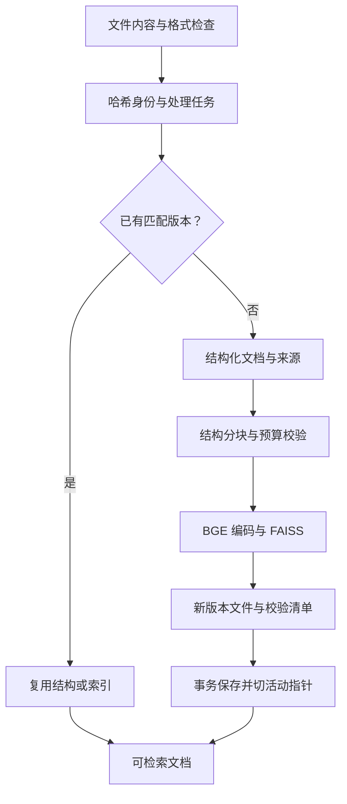
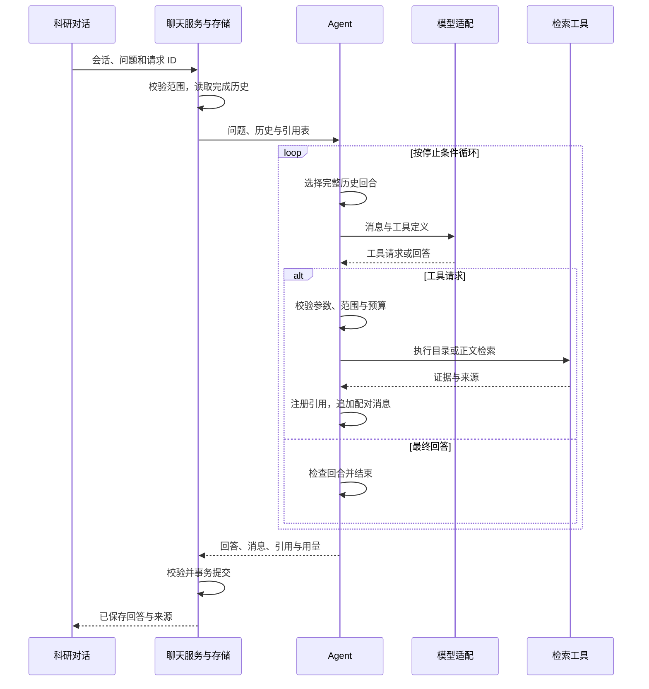

# 系统架构

Research RAG Agent 包含文档工作台、科研对话和数据集检索入口，复用混合检索接口与证据组织能力。各模块在 Python 应用内调用，模型供应商通过独立适配层接入。

## 模块职责

| 模块 | 入口 | 职责 |
|---|---|---|
| 文档交互 | [文档工作台](../pages/1_document_workbench.py) | 上传、文档列表、解析预览、分块和索引管理 |
| 对话交互 | [科研对话](../pages/2_research_chat.py) | 会话、模型配置、生成状态和引用展示 |
| 统一解析 | [UnifiedDocumentParser](../src/ingestion/parsers.py) | 文件检查、结构块、来源与解析提示 |
| 分块 | [StructuredChunker](../src/ingestion/structured_chunker.py) | 结构和 Token 预算、短段合并、原文跨度 |
| 文档存储 | [LocalDocumentStore](../src/storage/document_store.py) | 去重、版本、任务、索引发布与恢复 |
| 对话存储 | [ConversationStore](../src/storage/conversations.py) | 会话范围、回合状态、消息和引用事务 |
| 聊天服务 | [ResearchChatService](../src/chat_service.py) | 组织历史、运行 Agent、提交结果与状态 |
| Agent | [ResearchAgent](../src/agent/research_agent.py) | 模型请求、工具执行、停止条件和引用注册 |
| 上下文 | [SlidingWindow](../src/agent/context_window.py) | 输入预算、完整回合选择和工具配对 |
| 检索 | [StructuredDocumentRetriever](../src/retrieval/structured_retriever.py) | BM25、BGE/FAISS 和 RRF |
| 证据组织 | [ResearchRAGPipeline](../src/generation/rag_pipeline.py) | Anchor-First、章节邻居、证据预算与来源 |
| 模型适配 | [Provider 工厂](../src/llm/factory.py) | 标准消息与原生协议转换、工具和流式事件 |
| 评测 | [QASPER 协议](../src/evaluation/qasper_benchmark.py) | Gold 段落对齐、检索指标和统计区间 |

## 文档数据流

解析统一输出 StructuredDocument 与 DocumentBlock。PDF 使用真实页码和 bbox，DOCX 使用段落，MD/TXT 使用段落或行号；Chunk 保存原结构块和字符范围，多段合并保留全部来源 span。

正式索引用 BGE tokenizer 检查输入，默认 adaptive 为 480 Token、1200 字符、0 overlap。同页、同章节短段可合并；长段优先寻找段落、句末和空白边界。表格、公式、代码独立处理，超额拆分时标记 `atomic_split_required`。

SQLite 保存业务记录和 Chunk，原文件、向量与 FAISS 文件按不可变版本保存。文件落盘并校验后激活索引，恢复时核对模型身份、数量、哈希及有序映射。文档移出采用软删除，保留历史版本用于恢复和引用追溯。

## 问答数据流

工具 Schema 描述名称和参数，Python 执行器负责白名单、范围与次数限制。正文工具复用 Pipeline 的 `prepare` 获取证据，生成由外层 Agent 发起。失败回合保留状态，后续只重放已完成历史。

## 版本与会话

| 身份 | 用途 |
|---|---|
| document_id | 按原始内容哈希去重 |
| document_version | 区分解析结果和配置 |
| 分块 index_version | 区分分块配置、分块器和 tokenizer |
| 数据库 index_id | 绑定 Chunk 与 EmbeddingProfile 的保存版本 |
| conversation_id | 绑定文档与索引，隔离历史和引用 |
| request_id / turn_id | 幂等请求与回合状态 |
| tool_call_id | 工具请求与结果配对 |

完整历史保存在数据库，模型请求只选择适合当前预算的完整回合。切换模型后以问题/回答文本重放历史，保留原始协议记录；索引变化后，历史仍指向原来源，当前版本使用新会话。

输入预算预留输出与安全余量。生成输入使用序列化字节加封装余量估算，Embedding 使用实际 tokenizer，两类计数分别记录。流式片段由 GenerationTask 展示，完整回合提交后成为持久化结果。

## 运行记录与验证

结果记录工具轨迹、请求用量、窗口选择、无效引用与截断状态。文献及工具结果作为参考数据，执行权限由固定白名单与范围校验约束；Key 不写入持久化配置。

功能测试使用固定样例与 Mock，检索质量通过 [QASPER 评测](benchmark.md) 和 [章节实验](experiments.md) 报告。调用在线模型时，选中的问题、历史和证据会发送到所选服务。
